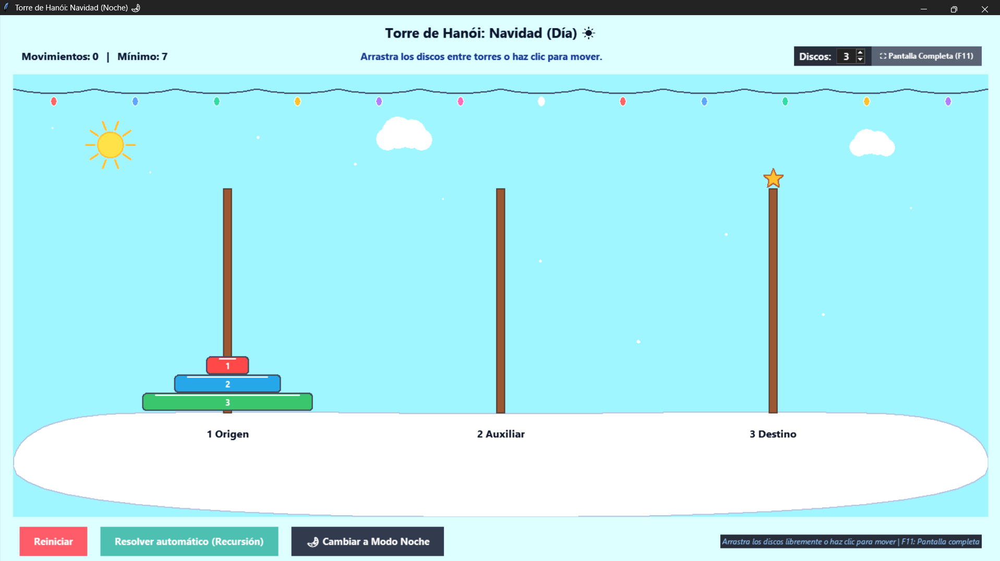
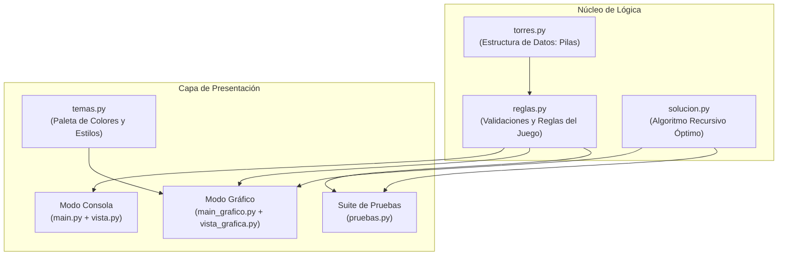

# Torre de Hanói — Edición Navideña 

<div align="center">

[](https://www.python.org/)
[](https://docs.python.org/3/library/tkinter.html)
[](#-comprobación-del-sistema-pruebas)
[](docs/documento_tecnico.md)

**Implementación interactiva, visual y educativa del clásico rompecabezas matemático de la Torre de Hanói.**  
Incluye **interfaz gráfica interactiva con arrastre de discos (Drag & Drop)**, dos temas navideños intercambiables, **modo consola ASCII**, resolvedor automático óptimo paso a paso y suite de pruebas unitarias.

> 📄 **Documentación Académica:** Puedes consultar el informe técnico formal y teórico del proyecto en **[docs/documento_tecnico.md](docs/documento_tecnico.md)**.

</div>

---

##  Vistas de la Interfaz Gráfica

La interfaz gráfica cuenta con gráficos vectoriales dinámicos dibujados en lienzo (`Canvas`), totalmente escalables a cualquier resolución de monitor y conmutación instantánea de temas:

###  Modo Navidad (Noche)
> *Atmósfera nocturna con cielo estrellado, luna creciente luminosa, guirnalda de luces festivas de colores, nieve suave y postes dorados.*

<p align="center">
  
</p>

###  Modo Navidad (Día)
> *Ambiente diurno radiante con cielo celeste, gran sol brillante, nubes invernales, postes de pino y manto de nieve pura iluminada.*

<p align="center">
  
</p>

#### Comparativa Rápida de Temas

| 🌙 Tema Navidad: Noche (`Interfaz1.png`) | ☀️ Tema Navidad: Día (`Interfaz2.png`) |
| :---: | :---: |
|  |  |
| **Fondo:** Azul medianoche con estrellas y luna | **Fondo:** Celeste brillante con sol radiante y nubes |
| **Estilo:** Postes dorados con brillo nocturno | **Estilo:** Postes de madera de pino natural |
| **Botón de acción:** `☀️ Cambiar a Modo Día` | **Botón de acción:** `🌙 Cambiar a Modo Noche` |

---

##  Tabla de Contenidos

1. [Características Principales](#-características-principales)
2. [Requisitos e Instalación](#-requisitos-e-instalación)
3. [Arquitectura del Proyecto](#-arquitectura-del-proyecto)
4. [Cómo Jugar: Interfaz Gráfica (Recomendado)](#-cómo-jugar-interfaz-gráfica-recomendado)
5. [Cómo Jugar: Modo Consola](#-cómo-jugar-modo-consola)
6. [Reglas del Juego y Fundamentos Matemáticos](#-reglas-del-juego-y-fundamentos-matemáticos)
7. [Comprobación del Sistema (Pruebas)](#-comprobación-del-sistema-pruebas)
8. [Documentación Técnica y Académica (UNIVO)](#-documentación-técnica-y-académica-univo)
9. [Preguntas Frecuentes y Solución de Problemas](#-preguntas-frecuentes-y-solución-de-problemas)

---

##  Características Principales

-  **Arrastrar y Soltar (Drag & Drop):** Toma cualquier disco superior con el ratón, arrástralo libremente por la pantalla y suéltalo sobre la torre de destino.
-  **Mover por Clics:** Modo de juego alternativo seleccionando la torre origen (el disco se elevará) y marcando la torre destino.
-  **Doble Tema Festivo:** Conmuta entre **Navidad (Noche)** 🌙 y **Navidad (Día)** ☀️ con un solo clic.
-  **Ventana Responsiva y Pantalla Completa:** Pulsa **F11** para alternar a pantalla completa sin perder proporciones; el canvas recalcula automáticamente coordenadas, postes y discos.
-  **Resolvedor Automático por Recursión:** Observa paso a paso cómo el algoritmo encuentra la solución matemáticamente perfecta en $2^n - 1$ movimientos.
-  **Dificultad Configurable:** Juega con **3 hasta 8 discos**, adaptando el reto desde 7 hasta 255 movimientos mínimos.
-  **Celebración de Victoria:** Animación con coronación de la Estrella Dorada en la Torre 3 al completar el árbol.
-  **Modo Consola:** Versión ligera y elegante para terminales y servidores sin entorno gráfico.
-  **Pruebas Automatizadas:** 22 verificaciones que garantizan la integridad de las reglas y la estructura de pilas.

---

##  Requisitos e Instalación

### 1. Requisitos
- **Python 3.8 o superior** instalado en Windows, macOS o Linux.
- **Sin dependencias externas:** Funciona 100% con la biblioteca estándar de Python (`tkinter`).

### 2. Comprobar instalación de Python
Abre tu terminal (PowerShell, CMD o bash) y verifica:

```bash
python --version
```
*(En Windows también puedes verificar con `py --version`)*.

### 3. Clonar o descargar el repositorio
Ubícate en el directorio del proyecto:

```bash
cd ESD-Torre-Hanoi
```

---

## 🏛️ Arquitectura del Proyecto

El proyecto está diseñado bajo el principio de **separación de responsabilidades**: el motor matemático y las reglas de validación son completamente independientes de la interfaz gráfica y de la consola.



### Estructura de Archivos

```text
ESD-Torre-Hanoi/
│
├──  Motor del Juego
│   ├── torres.py                 # Implementación de pilas para representar las 3 torres
│   ├── reglas.py                 # Validación de jugadas, contador de pasos y condición de victoria
│   └── solucion.py               # Algoritmo de recursión que calcula la secuencia óptima de pasos
│
├──  Interfaz Gráfica (GUI)
│   ├── main_grafico.py           # Punto de entrada para la aplicación de ventana
│   ├── vista_grafica.py          # Renderizado en Canvas, interactividad Drag & Drop y HUD
│   └── temas.py                  # Diccionario de estilos visuales (Navidad Noche y Navidad Día)
│
├──  Modo Consola
│   ├── main.py                   # Punto de entrada para jugar en terminal
│   └── vista.py                  # Renderizado de torres y discos en caracteres ASCII
│
├──  Verificación y Calidad
│   └── pruebas.py                # 22 pruebas unitarias automatizadas
│
└──  Recursos y Documentación
    ├── README.md                 # Manual de usuario y guía rápida
    ├── docs/                     # Documentación técnica y académica
    │   └── documento_tecnico.md  # Informe formal de Estructuras de Datos (UNIVO)
    └── assets/                   # Capturas de pantalla y recursos gráficos
        ├── Interfaz1.png         # Captura de pantalla: Tema Navidad Noche
        ├── Interfaz2.png         # Captura de pantalla: Tema Navidad Día
        └── interfaz.png          # Referencia de interfaz previa
```

---

##  Cómo Jugar: Interfaz Gráfica (Recomendado)

### 1. Iniciar el juego
Ejecuta en tu terminal:

```bash
python main_grafico.py
```
> *(En Windows, si el comando `python` no responde, ejecuta `py main_grafico.py`)*.

La ventana se iniciará por defecto maximizada, adaptándose a la resolución de tu pantalla con el tema festivo seleccionado.

### 2. Controles y Funcionalidades

| Control / Acción | ¿Cómo se usa? | Descripción |
|---|---|---|
| **Arrastrar y Soltar** | Clic sostenido + mover | Haz clic sobre el disco superior de una torre, arrástralo libremente y suéltalo sobre la torre de destino. Si la jugada es ilegal, el disco regresa automáticamente a su posición. |
| **Mover por Clics** | Clic origen ➔ Clic destino | Haz clic sobre la torre origen (el disco sube visualmente como indicador) y luego haz clic sobre la torre destino. Clic en la misma torre cancela la selección. |
| **⛶ Pantalla Completa** | Tecla `F11` o botón HUD | Maximiza la experiencia inmersiva. Pulsa `Esc` o `F11` para regresar a la vista de ventana estándar. |
| **Cambiar Tema Visual** | Botón de tema en el panel | Alterna al instante entre **Navidad (Noche)** 🌙 y **Navidad (Día)** ☀️. |
| **Selector de Discos** | Flechas de control (Spinbox) | Elige entre **3 y 8 discos** para iniciar una nueva partida con esa dificultad. |
| **Reiniciar** | Botón `Reiniciar` | Restablece el tablero a su configuración inicial con la cantidad actual de discos. |
| **Resolver Automático** | Botón `Resolver automático` | Activa la animación recursiva paso a paso que resuelve el juego en el número mínimo teórico de movimientos ($2^n - 1$). |

### 3. Sistema de Mensajes del HUD
-  **Mensajes Informativos (Celeste/Azul):** Indican el estado actual de la acción (p. ej., *"Torre 1 seleccionada como origen"* o instrucciones de uso).
-  **Mensajes de Advertencia (Rojo):** Te informan el motivo exacto por el cual una jugada no está permitida (p. ej., *"No puedes poner el disco 3 sobre el disco 1, que es más pequeño"*).
-  **Mensajes de Celebración (Dorado/Verde):** Se activan al completar la partida o al finalizar la solución automática, mostrando la estrella navideña en la cúspide de la Torre 3.

---

##  Cómo Jugar: Modo Consola

Para jugar en entornos sin interfaz gráfica o desde una sesión remota:

### 1. Iniciar la versión de terminal
```bash
python main.py
```
*(o `py main.py`)*

### 2. Flujo de Partida
1. **Configuración inicial:** Introduce el número de discos deseado (entre `3` y `8`) y pulsa `Enter`.
2. **Visualización del tablero ASCII:**
   ```text
        |              |              |       
       ###             |              |       
      #####            |              |       
     #######           |              |       
     1 ORIGEN      2 AUXILIAR     3 DESTINO   
   Movimientos: 0 | Minimo teorico: 7
   ```
3. **Ingreso de jugadas:**
   - La consola solicitará: `Mover desde la torre (1-3): ` (escribe `1`, `2` o `3`).
   - Luego solicitará: `Mover hacia la torre (1-3): ` (escribe la torre receptora).
4. **Validación en vivo:**
   - Jugadas válidas actualizan el gráfico y suman 1 al contador de movimientos.
   - Jugadas no permitidas muestran el error descriptivo sin penalizar tu contador.
5. **Fin de partida:** Al trasladar todos los discos a la **Torre 3**, el sistema despliega el resumen estadístico y te ofrece jugar una revancha (`s/n`).

---

##  Reglas del Juego y Fundamentos Matemáticos

El rompecabezas respeta estrictamente las tres reglas clásicas:

1. **Un solo disco a la vez:** Solo se puede mover el disco situado en la cima de una torre.
2. **Restricción de tamaño:** Ningún disco de mayor diámetro puede colocarse encima de uno de menor diámetro.
3. **Distribución en 3 torres:** Todos los discos inician en la **Torre 1 (Origen)** y deben trasladarse ordenadamente a la **Torre 3 (Destino)**, empleando la **Torre 2 (Auxiliar)** como puente.

###  Fórmula del Mínimo de Movimientos

El número mínimo de pasos necesarios para resolver una torre de $n$ discos está determinado por la relación de recurrencia:

$$M(n) = 2 \cdot M(n - 1) + 1 \implies M(n) = 2^n - 1$$

| Discos ($n$) | Mínimo Teórico de Movimientos ($2^n - 1$) |
| :---: | :---: |
| **3** | **7** |
| **4** | **15** |
| **5** | **31** |
| **6** | **63** |
| **7** | **127** |
| **8** | **255** |

---

##  Comprobación del Sistema (Pruebas)

El proyecto cuenta con **22 pruebas unitarias automáticas** en [pruebas.py](./pruebas.py) que verifican las reglas del juego y el resolvedor recursivo.

Para ejecutar la verificación:

```bash
python pruebas.py
```
*(o `py pruebas.py`)*

### Cobertura de Pruebas:
- ✅ Uso de las operaciones de pilas mediante movimientos válidos (`torres.py` y `reglas.py`).
- ✅ Rechazo de movimientos ilegales (disco mayor sobre menor, torre vacía, torre inexistente).
- ✅ Inmutabilidad de estado ante movimientos rechazados.
- ✅ Funcionamiento correcto del contador de movimientos válidos.
- ✅ Comprobación del cálculo de mínimo teórico para distintas cantidades de discos.
- ✅ Detección precisa de la condición de victoria.
- ✅ Optimalidad del resolvedor automático para 3, 4, 5 y 8 discos.

```text
OK     mover disco pequeño a torre vacia
OK     estado despues del movimiento
OK     el disco 3 sigue en la base
OK     disco 2 sobre disco 1 se rechaza
OK     el estado no cambia al rechazar
OK     mover desde torre vacia
OK     origen igual a destino
OK     torre 5 no existe
OK     el contador solo suma movimientos validos
OK     minimo con 3 discos
OK     minimo con 5 discos
OK     no hay victoria al inicio
OK     victoria al terminar
OK     se resolvio en el minimo
OK     resolver gana con 3 discos
OK     resolver usa el minimo con 3 discos
OK     resolver gana con 4 discos
OK     resolver usa el minimo con 4 discos
OK     resolver gana con 5 discos
OK     resolver usa el minimo con 5 discos
OK     resolver gana con 8 discos
OK     resolver usa el minimo con 8 discos

Total: 22 | Fallos: 0
```

---

##  Documentación Técnica y Académica (UNIVO)

Para una explicación exhaustiva sobre la teoría de ciencias de la computación que fundamenta este proyecto, consulta el informe formal ubicado en:

👉 **[docs/documento_tecnico.md](docs/documento_tecnico.md)**

### Contenido Destacado del Documento Técnico:
-  **Ficha Académica:** Proyecto para la cátedra de **Estructura de Datos** (Parcial 3) en la **Universidad de Oriente (UNIVO)**, a cargo del docente *MSc. William Josué Magaña Cruz*.
-  **Equipo de Trabajo y Roles:** Distribución de responsabilidades y temas de defensa de los integrantes:
  1. **Oscar Fabricio Guevara Aguilar (U20250466):** Estructura de datos (Pilas LIFO), lógica central y recursividad algorítmica.
  2. **Alex Gabriel Rivera Trujillo (U20250475):** Interfaz de consola, representación textual ASCII y bucle interactivo.
  3. **Henry Aldair Zelaya Cortez (U20251250):** Interfaz gráfica en Tkinter, canvas responsivo, Drag & Drop y doble tema Día/Noche.
  4. **Isvi José Castillo Cruz (U20251323):** Control de calidad, batería de 22 pruebas unitarias automatizadas y documentación.
-  **Justificación Formal de la Pila (LIFO):** Modelado abstracto de datos con operaciones primitivas (`push`, `pop`, `tope`), encapsulamiento e invariantes de estado.
-  **Análisis de Complejidad Computacional:** Demostración matemática por recurrencia e inducción de la cota temporal $O(2^n)$ y cota espacial en la pila de llamadas $O(n)$.
-  **Estrategia de Validación:** Análisis de los 22 casos de prueba automatizados y cobertura de condiciones límite.

---

##  Preguntas Frecuentes y Solución de Problemas

### 1. Mensaje: *"python no se reconoce como un comando interno o externo"*
En entornos Windows, es habitual que el lanzador estándar sea `py`. Prueba ejecutando:
```bash
py main_grafico.py
```
Si el inconveniente persiste, asegúrate de activar la casilla **"Add python.exe to PATH"** en el instalador oficial de [python.org](https://www.python.org/).

### 2. ¿Cómo salir de una partida en modo consola?
Puedes presionar `Ctrl + C` en cualquier instante para interrumpir la ejecución de forma segura y volver a la terminal.

### 3. Seleccioné una torre por error con el ratón, ¿cómo cancelo?
Haz clic nuevamente sobre la misma torre seleccionada. El sistema desmarcará la torre y regresará el disco a su posición de descanso.

### 4. ¿Cómo ajustar la velocidad de la animación automática?
En el archivo [vista_grafica.py](./vista_grafica.py), localiza la llamada `self.root.after(450, lambda: ejecutar_paso(indice + 1))`. Cambia el valor `450` (milisegundos) por un valor menor para mayor rapidez o mayor para observar cada paso detalladamente.
