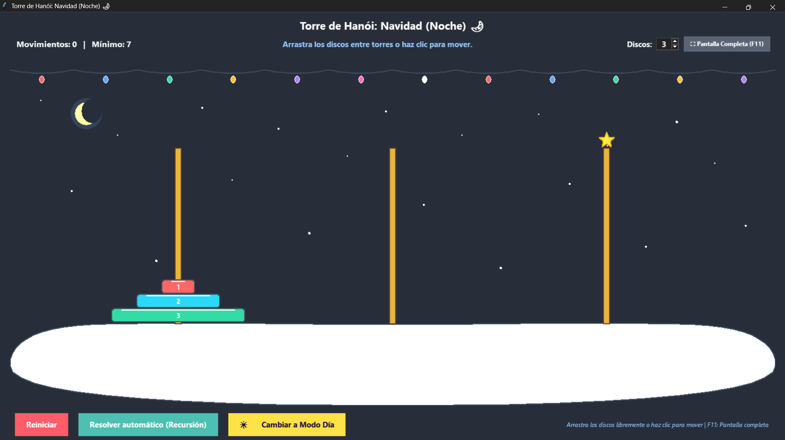

# Torre de Hanói — Edición Navideña

<div align="center">

[](https://www.python.org/)
[](https://flask.palletsprojects.com/)
[](#comprobación-del-sistema-pruebas)
[](docs/documento_tecnico.md)

**Implementación interactiva, visual y educativa del clásico rompecabezas matemático de la Torre de Hanói.**  
Incluye **interfaz web interactiva en el navegador con arrastre de discos (Drag & Drop)**, animación de salto parabólico, dos temas navideños intercambiables (Día y Noche), resolvedor automático óptimo paso a paso (recursión) y suite de 22 pruebas unitarias.

> **Documentación Académica:** Puedes consultar el informe técnico formal y teórico del proyecto en **[docs/documento_tecnico.md](docs/documento_tecnico.md)**.

</div>

---

## Vistas de la Interfaz Gráfica

La interfaz gráfica cuenta con gráficos vectoriales dinámicos dibujados en lienzo (`Canvas`), totalmente escalables a cualquier resolución de monitor y conmutación instantánea de temas:

### Modo Navidad (Noche)
> *Atmósfera nocturna con cielo estrellado, luna creciente luminosa, guirnalda de luces festivas de colores, nieve suave y postes dorados.*

<p align="center">
  
</p>

### Modo Navidad (Día)
> *Ambiente diurno radiante con cielo celeste, gran sol brillante, nubes invernales, postes de pino y manto de nieve pura iluminada.*

<p align="center">
  
</p>

#### Comparativa Rápida de Temas

| Tema Navidad: Noche (Interfaz1.png) | Tema Navidad: Día (Interfaz2.png) |
| :---: | :---: |
|  |  |
| **Fondo:** Azul medianoche con estrellas y luna | **Fondo:** Celeste brillante con sol radiante y nubes |
| **Estilo:** Postes dorados con brillo nocturno | **Estilo:** Postes de madera de pino natural |
| **Botón de acción:** `Cambiar a Modo Día` | **Botón de acción:** `Cambiar a Modo Noche` |

---

## Tabla de Contenidos

1. [Características Principales](#características-principales)
2. [Requisitos e Instalación](#requisitos-e-instalación)
3. [Arquitectura del Proyecto](#arquitectura-del-proyecto)
4. [Cómo Jugar: Modo Web en el Navegador](#cómo-jugar-modo-web-en-el-navegador)
5. [Reglas del Juego y Fundamentos Matemáticos](#reglas-del-juego-y-fundamentos-matemáticos)
6. [Comprobación del Sistema (Pruebas)](#comprobación-del-sistema-pruebas)
7. [Documentación Técnica y Académica (UNIVO)](#documentación-técnica-y-académica-univo)
8. [Preguntas Frecuentes y Solución de Problemas](#preguntas-frecuentes-y-solución-de-problemas)

---

## Características Principales

- **Arrastrar y Soltar (Drag & Drop):** Toma cualquier disco superior con el ratón o en pantallas táctiles, arrástralo libremente y suéltalo sobre la torre de destino.
- **Mover por Clics con Elevación:** Modo de juego alternativo seleccionando la torre origen (el disco se eleva 16px como indicador visual) y marcando la torre destino con trayectoria en arco parabólico.
- **Doble Tema Festivo:** Conmuta al instante entre **Navidad (Noche)** y **Navidad (Día)** con un solo clic.
- **Guirnalda de Luces Navideñas:** Luces de colores animadas que titilan a lo largo de la parte superior del tablero.
- **Pantalla Completa:** Pulsa **F11** o el botón del HUD para alternar a pantalla completa sin perder proporciones; el canvas recalcula automáticamente coordenadas, postes y discos.
- **Resolvedor Automático por Recursión:** Observa paso a paso cómo el algoritmo de $O(2^n)$ encuentra la solución óptima en el mínimo teórico ($2^n - 1$).
- **Dificultad Configurable:** Juega con **3 hasta 8 discos**, adaptando el reto desde 7 hasta 255 movimientos mínimos.
- **Celebración de Victoria:** Coronación con la Gran Estrella Dorada en la cúspide de la Torre 3, halo pulsante y lluvia animada de confeti.
- **Acceso Web Universal:** Se levanta con Flask en `http://localhost:5000` y abre automáticamente tu navegador web por defecto.
- **Pruebas Automatizadas:** 22 verificaciones que garantizan la integridad de las reglas y la estructura de pilas LIFO.

---

## Requisitos e Instalación

### 1. Requisitos
- **Python 3.8 o superior** instalado en Windows, macOS o Linux.
- **Flask:** Microframework web ligero para servir la aplicación.

### 2. Instalación rápida
Abre tu terminal en la carpeta del proyecto y ejecuta:

```bash
pip install flask
```

---

## Arquitectura del Proyecto

El proyecto está diseñado bajo el patrón **MVC (Modelo - Vista - Controlador)**, garantizando la estricta **separación de responsabilidades**: el motor matemático y las reglas de validación son completamente independientes de la interfaz gráfica y de la capa web.

```mermaid
graph TD
    subgraph Modelo (Estructura de Datos y Lógica)
        T["torres.py<br/>(Pilas LIFO: push, pop, tope)"] --> R["reglas.py<br/>(Validaciones y Reglas de Hanói)"]
        S["solucion.py<br/>(Algoritmo Recursivo Óptimo)"]
    end

    subgraph Controlador (Flask API)
        R --> C["app.py / main.py<br/>(Rutas REST y Gestión de Partida)"]
        S --> C
    end

    subgraph Vista (Interfaz Web)
        C --> VW["templates/index.html<br/>+ static/css/style.css<br/>+ static/js/app.js<br/>(HTML5 Canvas, Drag & Drop, Temas)"]
        TM["temas.py<br/>(Paleta Día / Noche)"] --> VW
    end

    subgraph Calidad
        R --> Tests["pruebas.py<br/>(22 Pruebas Unitarias)"]
        S --> Tests
    end
```

### Estructura de Archivos

```text
ESD-Torre-Hanoi/
│
├── Modelo (Estructura de Datos y Algoritmos)
│   ├── torres.py                 # Implementación de pilas LIFO (push, pop, tope)
│   ├── reglas.py                 # Validación de jugadas, movimientos y condición de victoria
│   ├── solucion.py               # Algoritmo recursivo que calcula la secuencia óptima (2^n - 1)
│   └── temas.py                  # Paletas de colores y estilos (Navidad Noche y Navidad Día)
│
├── Modo Web (Principal en el Navegador)
│   ├── main.py                   # Punto de entrada principal: levanta Flask y abre el navegador
│   ├── app.py                    # Controlador Flask con endpoints REST mínimos y claros
│   ├── templates/
│   │   └── index.html            # Plantilla HTML5 con estructura semántica y HUD
│   └── static/
│       ├── css/style.css         # Estilos visuales con variables CSS Día/Noche
│       └── js/app.js             # Motor Canvas: Drag & Drop, salto parabólico y confeti
│
├── Verificación y Pruebas
│   └── pruebas.py                # 22 pruebas unitarias automatizadas (22/22 OK)
│
└── Documentación y Recursos
    ├── README.md                 # Manual del usuario y documentación general
    ├── docs/documento_tecnico.md # Informe técnico formal (UNIVO)
    └── assets/                   # Capturas de pantalla e imágenes de interfaz
```

---

## Cómo Jugar: Modo Web en el Navegador

### 1. Iniciar la aplicación
Ejecuta en tu terminal:

```bash
python main.py
```
> *(En Windows también puedes usar `py main.py`)*.

El sistema mostrará:
```text
============================================================
  TORRE DE HANOI - EDICION NAVIDEÑA (MODO WEB)
  Abriendo en tu navegador: http://localhost:5000
  Presiona Ctrl+C en esta terminal para detener el servidor.
============================================================
```
Tu navegador predeterminado (Chrome, Edge, Firefox, etc.) se abrirá automáticamente en `http://localhost:5000` con el juego listo para jugar.

### 2. Controles y Funcionalidades

| Control / Acción | ¿Cómo se usa? | Descripción |
|---|---|---|
| **Arrastrar y Soltar** | Clic sostenido + mover | Haz clic sobre el disco superior de una torre, arrástralo libremente y suéltalo sobre la torre receptora. Si la jugada es ilegal, regresa suavemente a su lugar. |
| **Mover por Clics** | Clic origen ➔ Clic destino | Haz clic sobre la torre origen (el disco se eleva 16px como indicador visual) y luego haz clic en la torre destino. Viajará en un arco parabólico. |
| **Pantalla Completa** | Botón HUD o `F11` | Maximiza la experiencia en el monitor. Pulsa `Esc` o `F11` para salir. |
| **Cambiar Tema Visual** | Botón de tema | Alterna al instante entre **Navidad (Noche)** y **Navidad (Día)**. |
| **Selector de Discos** | Desplegable (3 a 8) | Elige entre **3 y 8 discos** para iniciar una nueva partida con esa dificultad. |
| **Reiniciar** | Botón `Reiniciar` | Restablece el tablero a su configuración inicial con la cantidad actual de discos. |
| **Resolver Automático** | Botón `Resolver automático` | Activa la animación paso a paso que resuelve el juego en el número mínimo de movimientos ($2^n - 1$). |

---

## Reglas del Juego y Fundamentos Matemáticos

El rompecabezas respeta estrictamente las tres reglas clásicas de Édouard Lucas (1883):

1. **Un solo disco a la vez:** Solo se puede mover el disco situado en la cima de una torre (operación `pop` de la pila origen y `push` en la pila destino).
2. **Restricción de tamaño:** Jamás puede colocarse un disco de radio mayor sobre otro de radio menor.
3. **Distribución en 3 torres:** Todos los discos inician apilados en la **Torre 1 (Origen)** y deben trasladarse ordenadamente a la **Torre 3 (Destino)**, empleando la **Torre 2 (Auxiliar)** como soporte.

### Fórmula del Mínimo de Movimientos

El número mínimo de pasos necesarios para resolver una torre de $n$ discos está determinado por la relación de recurrencia:

$$M(n) = 2 \cdot M(n - 1) + 1 \implies M(n) = 2^n - 1$$

| Discos ($n$) | Mínimo Teórico de Movimientos ($2^n - 1$) |
| :---: | :---: |
| **3** | **7** |
| **4** | **15** |
| **5** | **31** |
| **6** | **63** |
| **7** | **127** |
| **8** | **255** |

---

## Comprobación del Sistema (Pruebas)

El proyecto cuenta con **22 pruebas unitarias automáticas** en [pruebas.py](./pruebas.py) que verifican la integridad de las pilas LIFO, las reglas de validación y el resolvedor recursivo.

Para ejecutar la verificación:

```bash
python pruebas.py
```

### Cobertura de Pruebas:
- Operaciones de pilas LIFO mediante movimientos válidos (`torres.py` y `reglas.py`).
- Rechazo de movimientos ilegales (disco mayor sobre menor, torre vacía, torre inexistente, mismo origen y destino).
- Inmutabilidad de estado ante movimientos rechazados.
- Funcionamiento correcto del contador de movimientos válidos.
- Comprobación del cálculo de mínimo teórico para distintas cantidades de discos.
- Detección precisa de la condición de victoria.
- Optimalidad del resolvedor automático recursivo para 3, 4, 5 y 8 discos.

```text
OK     mover disco pequeño a torre vacia
OK     estado despues del movimiento
OK     el disco 3 sigue en la base
OK     disco 2 sobre disco 1 se rechaza
OK     el estado no cambia al rechazar
OK     mover desde torre vacia
OK     origen igual a destino
OK     torre 5 no existe
OK     el contador solo suma movimientos validos
OK     minimo con 3 discos
OK     minimo con 5 discos
OK     no hay victoria al inicio
OK     victoria al terminar
OK     se resolvio en el minimo
OK     resolver gana con 3 discos
OK     resolver usa el minimo con 3 discos
OK     resolver gana con 4 discos
OK     resolver usa el minimo con 4 discos
OK     resolver gana con 5 discos
OK     resolver usa el minimo con 5 discos
OK     resolver gana con 8 discos
OK     resolver usa el minimo con 8 discos

Total: 22 | Fallos: 0
```

---

## Documentación Técnica y Académica (UNIVO)

Para una explicación exhaustiva sobre la teoría de ciencias de la computación que fundamenta este proyecto, consulta el informe formal ubicado en:

**[docs/documento_tecnico.md](docs/documento_tecnico.md)**

### Equipo de Desarrollo y Roles:
1. **Oscar Fabricio Guevara Aguilar (U20250466):** Estructura de datos (Pilas LIFO: `push`, `pop`, `tope`), lógica central y recursividad algorítmica.
2. **Alex Gabriel Rivera Trujillo (U20250475):** Controlador Web, API Flask y Flujo de Ejecución (`app.py`, `main.py`).
3. **Henry Aldair Zelaya Cortez (U20251250):** Interfaz Gráfica y Frontend Visual (`static/`, `templates/`, `temas.py`).
4. **Isvi José Castillo Cruz (U20251323):** Aseguramiento de Calidad, suite de 22 pruebas unitarias y documentación técnica.

---

## Preguntas Frecuentes y Solución de Problemas

### 1. Mensaje: "python no se reconoce como un comando interno o externo"
En entornos Windows, es habitual que el lanzador estándar sea `py`. Prueba ejecutando:
```bash
py main.py
```
Asegúrate de marcar la casilla **"Add python.exe to PATH"** en el instalador oficial de [python.org](https://www.python.org/).

### 2. ¿Cómo detener el servidor web?
En la ventana de terminal donde ejecutaste `python main.py`, presiona `Ctrl + C` para detener el servidor de forma segura.

### 3. Seleccioné una torre por error con el ratón, ¿cómo cancelo?
Haz clic nuevamente sobre la misma torre seleccionada. El sistema desmarcará la torre y regresará el disco a su posición original.
