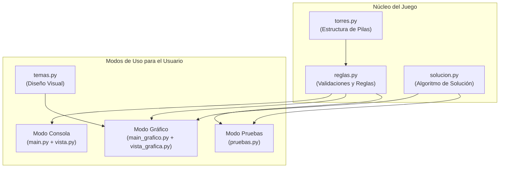
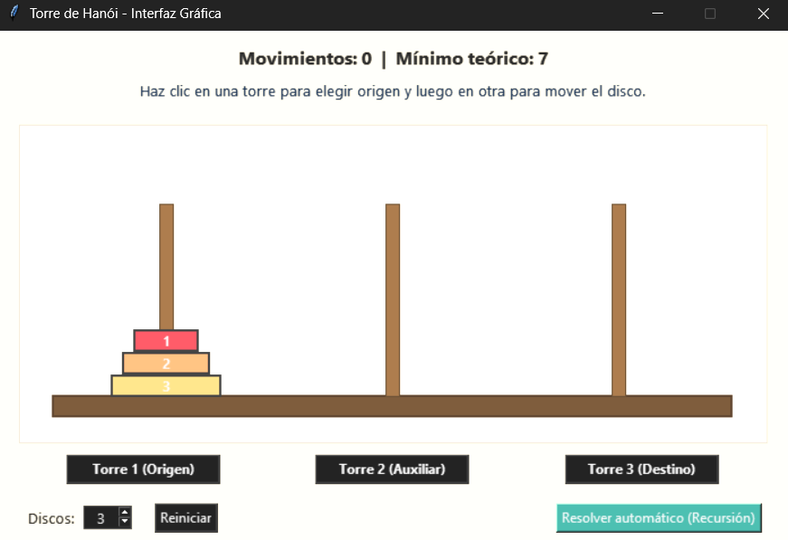

# 🗼 Torre de Hanói — Manual de Usuario

Bienvenido al juego de la **Torre de Hanói**. Esta aplicación permite jugar tanto en una **interfaz gráfica con ventana** como en la **consola de comandos**, además de incluir un resolvedor automático paso a paso y comprobaciones del sistema.

Este manual explica cómo empezar a usar el juego desde cero, cómo interactuar con él y cómo está construido internamente.

---

## 📋 Tabla de Contenidos

1. [Requisitos e Instalación](#-requisitos-e-instalación)
2. [Arquitectura del Proyecto](#-arquitectura-del-proyecto)
3. [Cómo Jugar: Interfaz Gráfica (Recomendado)](#-cómo-jugar-interfaz-gráfica-recomendado)
4. [Cómo Jugar: Modo Consola](#-cómo-jugar-modo-consola)
5. [Reglas del Juego](#-reglas-del-juego)
6. [Comprobación del Sistema (Pruebas)](#-comprobación-del-sistema-pruebas)
7. [Preguntas Frecuentes y Solución de Problemas](#-preguntas-frecuentes-y-solución-de-problemas)

---

## 🚀 Requisitos e Instalación

### 1. Requisitos
- **Python 3.8 o superior** instalado en tu computadora (Windows, Mac o Linux).
- **No necesitas instalar ninguna librería externa.** Todo funciona con las herramientas incluidas por defecto en Python (`tkinter`).

### 2. Comprobar que tienes Python listo
Abre tu terminal (PowerShell, CMD o Terminal) y escribe:

```bash
python --version
```

*(Si en Windows no reconoce `python`, prueba escribiendo `py --version`)*.

### 3. Abrir la carpeta del juego
Desde la terminal, ubícate en la carpeta donde descargaste el proyecto:

```bash
cd ESD-Torre-Hanoi
```

---

## 🏛️ Arquitectura del Proyecto

El proyecto está diseñado bajo una arquitectura limpia y modular: **la lógica del juego está completamente separada de la forma en que se muestra al usuario**. Esto permite que el mismo motor de reglas funcione tanto en la ventana gráfica como en la consola.

### Estructura de Archivos

```text
ESD-Torre-Hanoi/
│
├── 🧠 Motor del Juego
│   ├── torres.py          # Maneja las torres como pilas (insertar, sacar y ver tope)
│   ├── reglas.py          # Aplica las reglas del juego, valida jugadas y cuenta movimientos
│   └── solucion.py        # Algoritmo inteligente que resuelve el juego automáticamente
│
├── 🖥️ Modo Ventana Gráfica
│   ├── main_grafico.py    # Archivo para iniciar la interfaz gráfica
│   ├── vista_grafica.py   # Dibuja las torres, discos y botones en la ventana
│   └── temas.py           # Colores y estilo visual del tablero
│
├── ⌨️ Modo Consola
│   ├── main.py            # Archivo para iniciar el juego en la terminal
│   └── vista.py           # Dibuja las torres en texto dentro de la terminal
│
├── 🧪 Verificación
│   └── pruebas.py         # Suite de pruebas automáticas para comprobar que todo funciona
│
└── 📄 Documentación y Recursos
    ├── README.md          # Este manual de usuario
    ├── assets/            # Imágenes y recursos complementarios
    ├── docs/              # Documentos adicionales
    └── evidencias/        # Capturas de pantalla de ejemplo
```

### ¿Cómo se comunican las partes?



---

## 🎨 Cómo Jugar: Interfaz Gráfica (Recomendado)

Es la forma más visual e intuitiva de interactuar con el juego.

### 1. Iniciar la ventana
Ejecuta en tu terminal:

```bash
python main_grafico.py
```
*(o `py main_grafico.py`)*

Se abrirá una ventana con el tablero de madera, las tres torres y los discos apilados.



### 2. Controles en la ventana

| Acción | ¿Cómo se hace? |
|--------|----------------|
| **Seleccionar disco a mover** | Haz clic sobre la torre que tiene el disco. El disco superior se elevará ligeramente y aparecerá una flecha roja indicando que está seleccionado. |
| **Colocar el disco** | Haz clic sobre la torre a donde deseas moverlo. El juego validará el movimiento al instante. |
| **Uso con botones** | Si prefieres no hacer clic en los dibujos, puedes presionar los botones `Torre 1`, `Torre 2` o `Torre 3` situados debajo del lienzo. |
| **Cambiar dificultad** | En el campo inferior **"Discos"**, usa las flechas para elegir entre **3 y 8 discos** y haz clic en **Reiniciar**. |
| **Reiniciar la partida** | Presiona el botón **Reiniciar** en cualquier momento para volver a colocar los discos al inicio. |
| **Resolver automáticamente** | Presiona **Resolver automático (Recursión)**. El juego resolverá la torre por ti paso a paso mediante una animación con el menor número posible de movimientos. |

### 3. Mensajes en pantalla
- **Mensaje azul/gris:** Te guía sobre qué paso sigue (ejemplo: *"Torre 1 seleccionada como origen"*).
- **Mensaje rojo:** Te avisa cuando intentas hacer una jugada no permitida y te explica por qué (ejemplo: *"No puedes poner un disco grande sobre uno pequeño"*).
- **Mensaje verde:** Aparece cuando logras ganar la partida o cuando la solución automática finaliza.

---

## ⌨️ Cómo Jugar: Modo Consola

Si prefieres jugar directamente desde la terminal de texto sin ventanas:

### 1. Iniciar el juego
Ejecuta en tu terminal:

```bash
python main.py
```
*(o `py main.py`)*

### 2. Flujo del juego
1. **Elige la cantidad de discos:** Escribe un número entre `3` y `8` y presiona `Enter`.
2. **Observa el tablero:** Las tres torres aparecerán dibujadas con caracteres de texto:
   ```text
        |              |              |       
       ###             |              |       
      #####            |              |       
     #######           |              |       
     1 ORIGEN      2 AUXILIAR     3 DESTINO   
   Movimientos: 0 | Minimo teorico: 7
   ```
3. **Realiza tu jugada:**
   - La terminal te preguntará: `Mover desde la torre (1-3): ` (escribe `1`, `2` o `3` y presiona `Enter`).
   - Luego te preguntará: `Mover hacia la torre (1-3): ` (escribe el destino y presiona `Enter`).
4. **Si el movimiento es válido:** El tablero se actualizará y el contador de movimientos sumará 1.
5. **Si el movimiento es inválido:** El programa te mostrará el error y te permitirá volver a intentar sin penalizar tus movimientos.
6. **Victoria:** Cuando logres trasladar todos los discos a la **Torre 3 (Destino)**, el juego mostrará un mensaje de felicitaciones con tus estadísticas.

---

## 📜 Reglas del Juego

El juego sigue las tres reglas clásicas de la **Torre de Hanói**:

1. **Solo se puede mover un disco a la vez:** En cada jugada solo puedes tomar el disco que está en la parte superior de una torre.
2. **Ningún disco grande puede ir sobre uno más pequeño:** Solo puedes colocar un disco en una torre vacía o sobre un disco de mayor tamaño.
3. **Solo se pueden usar las 3 torres:** El juego inicia con todos los discos ordenados en la **Torre 1 (Origen)** y el objetivo final es llevarlos a la **Torre 3 (Destino)** usando la **Torre 2 (Auxiliar)** como apoyo.

### ¿Cuál es la meta?
Completar el juego en la menor cantidad posible de movimientos. La fórmula matemática para el número mínimo de pasos es:

$$\text{Mínimo de movimientos} = 2^n - 1$$

*(Donde $n$ es la cantidad de discos)*:
- **3 discos:** 7 movimientos
- **4 discos:** 15 movimientos
- **5 discos:** 31 movimientos
- **6 discos:** 63 movimientos
- **7 discos:** 127 movimientos
- **8 discos:** 255 movimientos

---

## 🧪 Comprobación del Sistema (Pruebas)

El proyecto incluye un módulo de autodiagnóstico que verifica que todas las reglas, validaciones, contadores y algoritmos funcionen de forma correcta.

Para ejecutar las pruebas:

```bash
python pruebas.py
```

### Resultado esperado:
Todas las comprobaciones deben marcar `OK` y finalizar con cero fallos:

```text
OK     mover disco pequeño a torre vacia
OK     estado despues del movimiento
OK     el disco 3 sigue en la base
OK     disco 2 sobre disco 1 se rechaza
OK     el estado no cambia al rechazar
OK     mover desde torre vacia
OK     origen igual a destino
OK     torre 5 no existe
OK     el contador solo suma movimientos validos
OK     minimo con 3 discos
OK     minimo con 5 discos
OK     no hay victoria al inicio
OK     victoria al terminar
OK     se resolvio en el minimo
OK     resolver gana con 3 discos
OK     resolver usa el minimo con 3 discos
OK     resolver gana con 4 discos
OK     resolver usa el minimo con 4 discos
OK     resolver gana con 5 discos
OK     resolver usa el minimo con 5 discos
OK     resolver gana con 8 discos
OK     resolver usa el minimo con 8 discos

Total: 22 | Fallos: 0
```

---

## ❓ Preguntas Frecuentes y Solución de Problemas

### 1. Me sale: *"python no se reconoce como un comando interno o externo"*
- En Windows, es muy común que el comando sea `py` en lugar de `python`. Intenta ejecutando:
  ```bash
  py main_grafico.py
  ```
- Si ninguno funciona, asegúrate de tener Python instalado desde [python.org](https://www.python.org/) y marcar la casilla **"Add python.exe to PATH"** durante la instalación.

### 2. ¿Cómo salgo del juego en consola?
- Puedes presionar `Ctrl + C` en cualquier momento para detener la ejecución y volver a la terminal.

### 3. Hice clic en una torre por error en la ventana gráfica, ¿cómo cancelo?
- Simplemente haz clic en la misma torre que habías seleccionado. El sistema cancelará la selección y podrás elegir otra.

### 4. ¿Puedo cambiar la velocidad de la solución automática?
- Sí. En el archivo [vista_grafica.py](file:///c:/Users/isvij/ESD-Torre-Hanoi/vista_grafica.py), dentro del método `resolver_automatico()`, puedes ajustar el valor de tiempo en `self.root.after(500, ...)` (500 milisegundos por defecto) a un número menor (ej. 250 ms) para que sea más rápido.
