# Documento Técnico: Torre de Hanói
**Universidad de Oriente (UNIVO)**  
**Facultad de Ingeniería y Arquitectura**  
**Carrera de Ingeniería en Desarrollo de Software**  
**Asignatura:** Estructura de Datos · Parcial 3   
**Catedrático:** MSc. William Josué Magaña Cruz  
**San Miguel, El Salvador · Noviembre de 2026**  

---

## 1. Datos Generales y del Equipo

* **Institución Educativa:** Universidad de Oriente (UNIVO)
* **Facultad:** Facultad de Ingeniería y Arquitectura
* **Carrera:** Ingeniería en Desarrollo de Software
* **Asignatura:** Estructura de Datos
* **Ciclo / Evaluación:** Parcial 3 — Proyecto Práctico de Programación
* **Docente Titular:** MSc. William Josué Magaña Cruz
* **Equipo de Desarrollo:**
  1. **Oscar Fabricio Guevara Aguilar — U20250466**  
     *Rol:* Estructuras de Datos y Lógica Central (`torres.py`, `reglas.py`, `solucion.py`).  
     *Defensa individual:* Pilas LIFO, operaciones primitivas `push`/`pop`/`tope`, validaciones de reglas y recursividad algorítmica.
  2. **Alex Gabriel Rivera Trujillo — U20250475**  
     *Rol:* Controlador Web, API Flask y Flujo de Ejecución (`app.py`, `main.py`).  
     *Defensa individual:* Arquitectura de rutas HTTP con Flask, serialización JSON de estados, endpoints REST de validación de jugadas y desacoplamiento del backend con el navegador.
  3. **Henry Aldair Zelaya Cortez — U20251250**  
     *Rol:* Interfaz Gráfica y Experiencia Visual (`static/`, `templates/`, `temas.py`).  
     *Defensa individual:* Renderizado vectorial en Canvas HTML5, mecánicas de arrastrar y soltar (*Drag & Drop*), física de salto parabólico, adaptabilidad responsiva y conmutación de temas Día/Noche.
  4. **Isvi José Castillo Cruz — U20251323**  
     *Rol:* Aseguramiento de Calidad, Pruebas y Documentación (`pruebas.py`, `evidencias/`, `docs/`, `README.md`).  
     *Defensa individual:* Batería de 22 pruebas unitarias automatizadas, cobertura de casos válidos/inválidos, evidencias y documentación técnica.

---

## 2. Descripción General del Problema

El rompecabezas de la **Torre de Hanói** fue propuesto originalmente en 1883 por el matemático francés Édouard Lucas. Consta de tres varillas verticales (denominadas usualmente **Origen**, **Auxiliar** y **Destino**) y un conjunto de $n$ discos circulares de radios estrictamente decrecientes apilados en el poste de Origen.

El objetivo consiste en trasladar la totalidad de la torre de discos hacia la varilla de Destino, utilizando la varilla Auxiliar como soporte intermedio y respetando en todo momento tres reglas inviolables:
1. **Manipulación unitaria:** En cada movimiento solo puede trasladarse un único disco.
2. **Restricción de cima:** En cada turno solo es lícito tomar el disco que se encuentre en la cúspide (tope) de una torre.
3. **Condición de tamaño no decreciente:** Jamás puede colocarse un disco de radio mayor sobre otro de radio menor.

Cualquier acción que vulnere alguna de estas tres condiciones debe ser interceptada por el sistema, rechazada sin alterar el estado del tablero y explicada al usuario de forma clara e inequívoca.

---

## 3. Justificación de la Estructura de Datos: La Pila (LIFO)

En las ciencias de la computación, una **Pila (*Stack*)** es una estructura de datos lineal que modela una colección ordenada de elementos bajo la disciplina de acceso **LIFO** (*Last In, First Out* — "El último elemento en entrar es el primero en salir").

```text
       CIMA / TOPE ---> | [1] |   <-- Único disco que puede desapilarse (pop)
                        | [2] |
       BASE ----------> | [3] |   <-- Disco inaccesible hasta vaciar los superiores
                        +-----+
                        TORRE 1
```

### 3.1 Idoneidad del Modelo LIFO para Hanói
La Torre de Hanói constituye el ejemplo físico por excelencia de una Pila:
* **Imposibilidad física de acceso intermedio:** No es posible extraer mecánicamente el disco de la base sin haber retirado con antelación los discos que reposan sobre él.
* **Operación atómica en el extremo superior:** Al restringir las operaciones únicamente a la cima de cada torre, la regla clásica *"mover solo el disco superior"* se cumple por construcción matemática, sin necesidad de algoritmos de búsqueda o ordenamientos adicionales.
* **Comparación directa en $\mathcal{O}(1)$:** Para evaluar si un disco puede ser depositado en otra torre, basta con comparar su tamaño contra el disco retornado por la operación `tope(pila_destino)`.

### 3.2 Implementación Técnica en `torres.py`
En apego riguroso a los contenidos vistos en clase (clases 12 a 16 del repositorio de la asignatura), las pilas se implementaron sobre listas nativas de Python mediante funciones independientes:

```python
# torres.py: implementacion de pilas puras sobre listas
def push(pila, disco):
    """Inserta un disco en la cima de la torre en O(1)."""
    pila.append(disco)

def pop(pila):
    """Extrae y retorna el disco del tope en O(1)."""
    return pila.pop()

def tope(pila):
    """Inspecciona la cima sin extraer el elemento en O(1)."""
    if len(pila) == 0:
        return None
    return pila[-1]

def crear_torres(cantidad_discos):
    """Inicializa las 3 torres apilando de mayor a menor en la torre 0."""
    torres = [[], [], []]
    for disco in range(cantidad_discos, 0, -1):
        push(torres[0], disco)
    return torres
```

> **Frase de síntesis para la defensa:**  
> *"Cada torre es una pila porque en Hanói solo el último disco en entrar tiene la posibilidad física y lógica de salir."*

---

## 4. Estado del Juego y Arquitectura de Software

Para respetar las pautas del curso y evitar variables globales dispersas, el estado completo de la partida se concentra en un único **diccionario de Python** (estructura estudiada en la clase 11):

```python
juego = {
    "discos": 3,
    "torres": [[3, 2, 1], [], []],
    "movimientos": 0
}
```

### 4.1 Ciclo de Vida de una Jugada
La separación de responsabilidades asegura que ni la consola ni la interfaz gráfica alteren las pilas directamente. Toda interacción atraviesa el siguiente flujo validado:

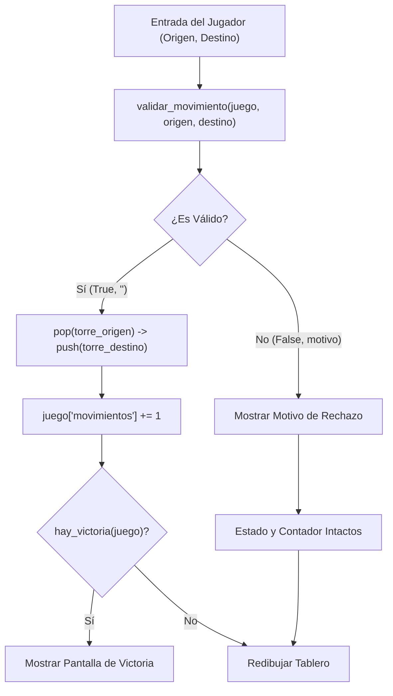

---

## 5. Catálogo Modular de Funciones (Contrato de Interfaz)

El software sigue una arquitectura desacoplada donde cada archivo posee una responsabilidad única:

| Archivo | Función / Clase | Parámetros que recibe | Valor que retorna | Descripción funcional |
| :--- | :--- | :--- | :--- | :--- |
| `torres.py` | `push(pila, disco)` | `pila: list`, `disco: int` | `None` | Inserta el disco al final de la lista. |
| `torres.py` | `pop(pila)` | `pila: list` | `int` | Retira y retorna el último elemento. |
| `torres.py` | `tope(pila)` | `pila: list` | `int` o `None` | Consulta el último elemento sin alterarlo. |
| `torres.py` | `crear_torres(n)` | `n: int` | `list[list]` | Genera `[[n..1], [], []]`. |
| `reglas.py` | `crear_juego(n)` | `n: int` | `dict` | Instancia el diccionario de estado del juego. |
| `reglas.py` | `minimo_teorico(n)` | `n: int` | `int` | Evalúa la fórmula $2^n - 1$. |
| `reglas.py` | `validar_movimiento(...)`| `juego, origen, destino` | `tuple(bool, str)` | Evalúa si la jugada respeta las 4 reglas. |
| `reglas.py` | `mover_disco(...)` | `juego, origen, destino` | `tuple(bool, str)` | Aplica `push`/`pop` y suma al contador si es válido. |
| `reglas.py` | `hay_victoria(juego)` | `juego: dict` | `bool` | Retorna `True` si la Torre 3 tiene los $n$ discos. |
| `solucion.py` | `resolver(...)` | `n, orig, dest, aux, pasos` | `None` | Genera recursivamente la secuencia óptima. |
| `app.py` | `iniciar()`, `mover()`, `resolver_hanoi()` | Endpoints REST | `JSON` | Controlador web Flask que comunica el frontend con el modelo. |
| `main.py` | `main()` | Ninguno | `None` | Punto de entrada principal que levanta Flask y abre el navegador. |
| `temas.py` | Diccionario `TEMAS` | Ninguno | `dict` | Paletas y componentes para Día y Noche. |
| `templates/index.html` | Vista HTML5 | Plantilla Jinja2 | `HTML` | Estructura del tablero, HUD de movimientos y controles. |
| `static/js/app.js` | Motor interactivo Canvas | Eventos DOM | `None` | Renderizado gráfico, Drag & Drop y animaciones. |
| `pruebas.py` | `comprobar(...)` | `nombre, obtenido, esperado` | `None` | Ejecuta las 22 pruebas unitarias automatizadas. |

---

## 6. Validaciones Lógicas y Mensajes de Rechazo

En concordancia con los requisitos de la rúbrica evaluativa, la función `validar_movimiento` analiza cuatro condiciones en cascada antes de autorizar cualquier cambio de estado:

| Orden de Evaluación | Condición Lógica | Mensaje Exacto Retornado al Usuario | Justificación Conceptual |
| :---: | :--- | :--- | :--- |
| **1** | `origen < 0 or origen > 2` <br> `destino < 0 or destino > 2` | `"Esa torre no existe. Usa 1, 2 o 3."` | Evita errores de índice (*IndexError*) y valida entradas numéricas del usuario. |
| **2** | `origen == destino` | `"El origen y el destino son la misma torre."` | Previene movimientos redundantes que alterarían injustamente el contador. |
| **3** | `tope(torres[origen]) is None` | `"La torre de origen esta vacia, no hay disco que mover."` | Protege contra la extracción sobre una pila vacía (*Stack Underflow*). |
| **4** | `encima is not None and disco > encima` | `"No puedes poner el disco X sobre el disco Y, que es mas pequeño."` | Aplica la regla clásica de tamaño inviolable de la Torre de Hanói. |

Si todas las pruebas condicionales resultan satisfactorias, la función retorna `(True, "")`, permitiendo que `mover_disco()` desapile del origen y apile en el destino.

---

## 7. Solución Automática mediante Recursión y Pila de Llamadas

La solución recursiva implementada en `solucion.py` se basa en la estrategia de diseño algorítmico **Divide y Vencerás**, alineada con las clases 27 y 28 de la cátedra:

```python
# solucion.py: solucion optima por recursion
def resolver(n, origen, destino, auxiliar, pasos):
    # Caso Base: si no hay discos, se detiene la recursion
    if n == 0:
        return
    # Paso 1: trasladar n - 1 discos a la torre auxiliar
    resolver(n - 1, origen, auxiliar, destino, pasos)
    # Paso 2: trasladar el disco de mayor tamaño directamente al destino
    pasos.append((origen, destino))
    # Paso 3: trasladar los n - 1 discos desde el auxiliar hacia el destino
    resolver(n - 1, auxiliar, destino, origen, pasos)
```

### 7.1 Deducción Matemática de la Complejidad
Sea $T(n)$ el número de movimientos requeridos para resolver una torre de $n$ discos:
* Para mover $n - 1$ discos a la torre auxiliar: $T(n - 1)$ movimientos.
* Para mover el disco más grande a la torre destino: $1$ movimiento.
* Para mover los $n - 1$ discos de la auxiliar al destino: $T(n - 1)$ movimientos.

Planteamiento de la relación de recurrencia:
$$\begin{cases} T(0) = 0 \\ T(n) = 2 \cdot T(n - 1) + 1 \end{cases}$$

Desarrollando por expansión telescópica:
$$\begin{aligned}
T(n) &= 2 \cdot T(n - 1) + 1 \\
&= 2 \cdot [2 \cdot T(n - 2) + 1] + 1 = 2^2 \cdot T(n - 2) + 2 + 1 \\
&= 2^3 \cdot T(n - 3) + 2^2 + 2^1 + 2^0 \\
&\dots \\
&= 2^n \cdot T(0) + \sum_{k=0}^{n-1} 2^k = 0 + (2^n - 1) = 2^n - 1
\end{aligned}$$

Por consiguiente, la complejidad temporal estricta del algoritmo es:
$$\mathcal{O}(2^n)$$

### 7.2 Relación entre la Recursión y la Pila de Llamadas (*Call Stack*)
Existe una íntima conexión conceptual entre las estructuras de datos del proyecto:
* Cada torre del juego es una **Pila de Discos**.
* El motor de ejecución de Python gestiona las llamadas recursivas de `resolver` mediante su **Pila de Llamadas (*Call Stack*)**.
* Cuando se invoca `resolver(3, ...)`, el marco de activación correspondiente a $n=3$ se almacena en la cima del *Call Stack* y queda en pausa mientras se resuelven las llamadas anidadas para $n=2$ y $n=1$. Cuando el caso base $n=0$ retorna, los marcos se desapilan ordenadamente, reflejando de forma idéntica el comportamiento LIFO.

---

## 8. Evidencias de Pruebas y Validación Experimental

Para respaldar la entrega académica se recopilaron las evidencias fotográficas de cada aspecto del sistema en la carpeta `evidencias/`.

### 8.1 Verificación Automatizada (Pruebas Unitarias)
El script `pruebas.py` ejecuta 22 pruebas rigurosas sin frameworks externos:

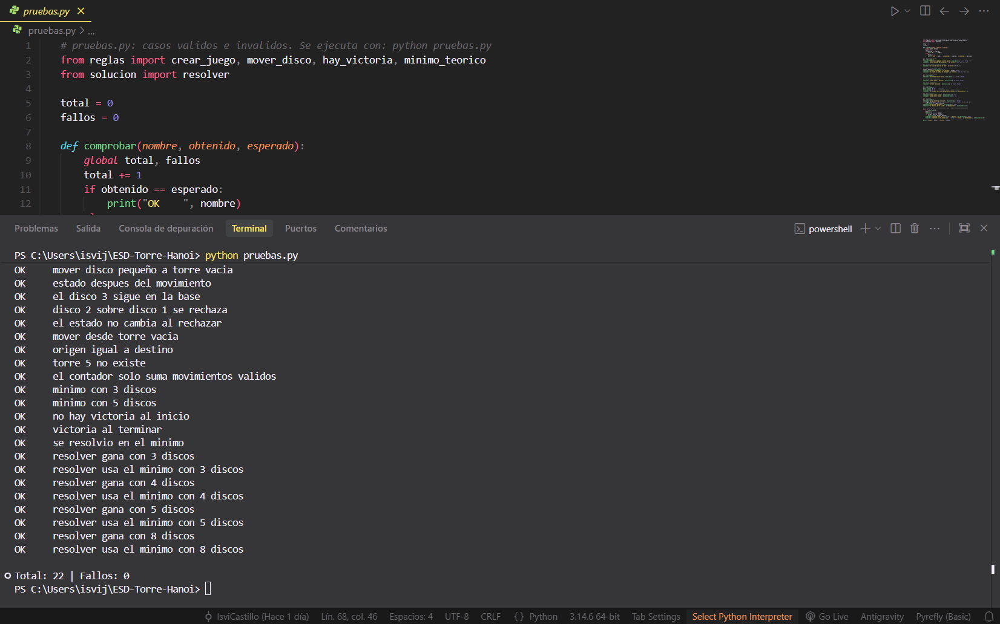  
*Figura 1: Ejecución completa de la batería de pruebas automatizadas reportando 22 casos evaluados y 0 fallos.*

---

### 8.2 Modo Consola: Operaciones Válidas e Inválidas

| Evidencia 02: Movimiento Válido | Evidencia 03: Disco Mayor sobre Menor |
| :---: | :---: |
| 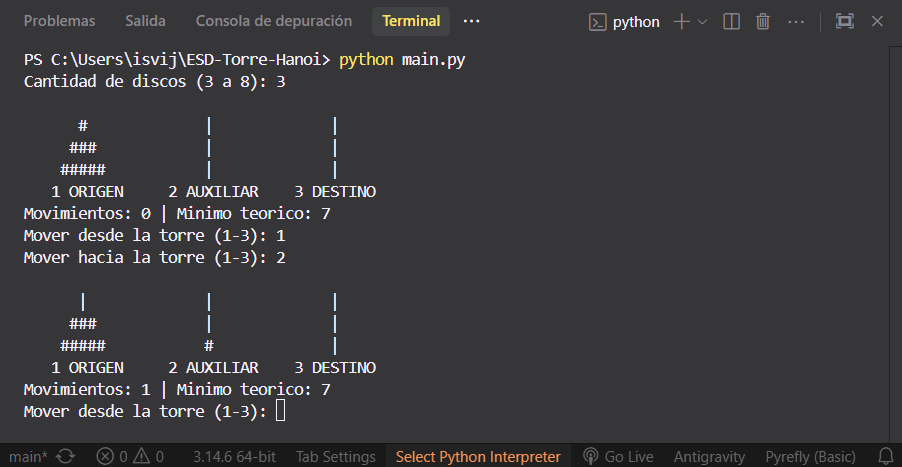 | 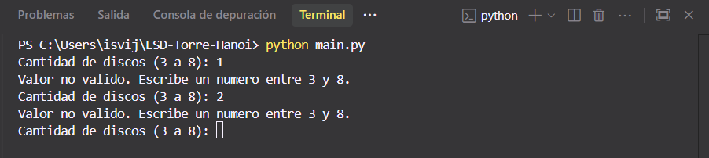 |
| *Figura 2: Extracción válida del disco 1 desde Torre 1 hacia Torre 2. El contador incrementa a 1 y el disco 3 permanece intacto en la base (comprobación LIFO).* | *Figura 3: Intento de mover el disco 2 sobre el disco 1. La regla 4 intercepta la jugada, explica el motivo y conserva el contador intacto en 1.* |

| Evidencia 04: Torre Origen Vacía | Evidencia 05: Mismo Origen y Destino |
| :---: | :---: |
| 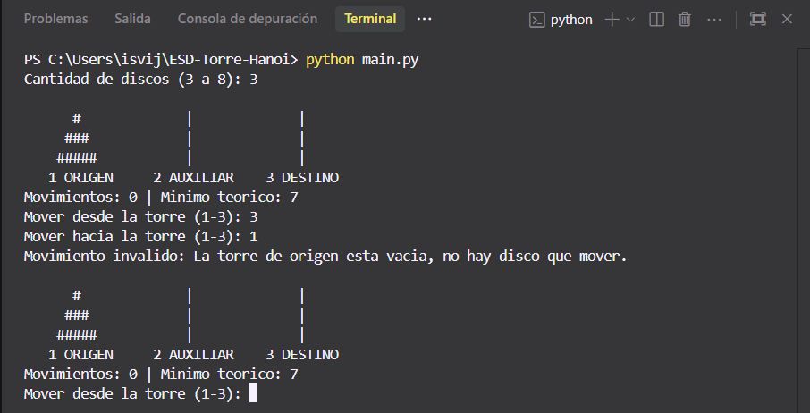 | 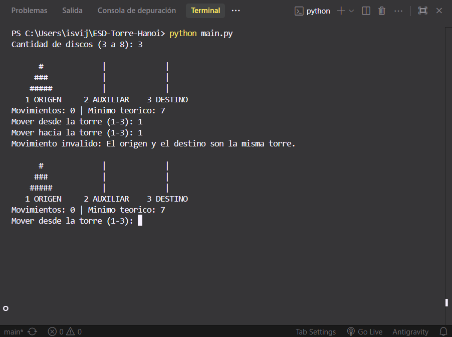 |
| *Figura 4: Intento de desapilar desde la Torre 3 (vacía). La regla 3 intercepta la jugada por Stack Underflow sin alterar el juego.* | *Figura 5: Ingreso de origen 1 y destino 1. La regla 2 cancela la operación redundante.* |

| Evidencia 06: Torre Fuera de Rango | Evidencia 07: Pantalla de Victoria |
| :---: | :---: |
| 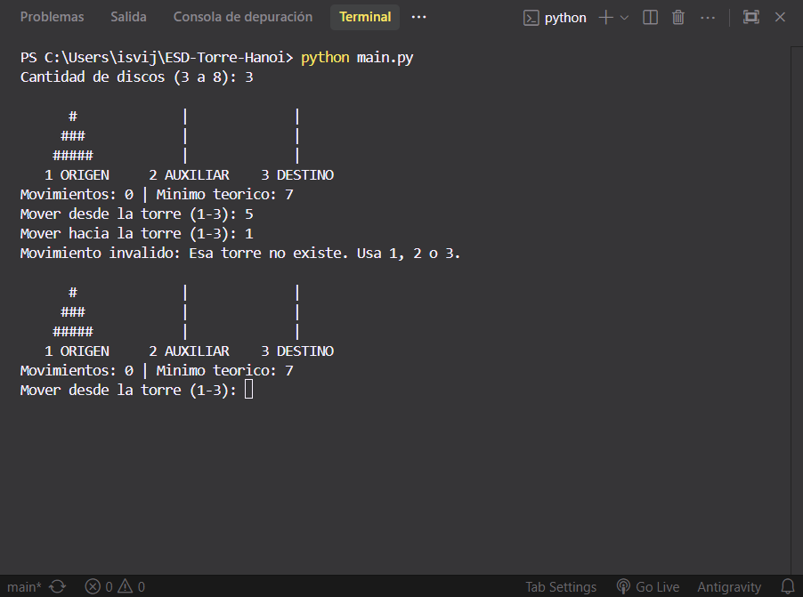 | 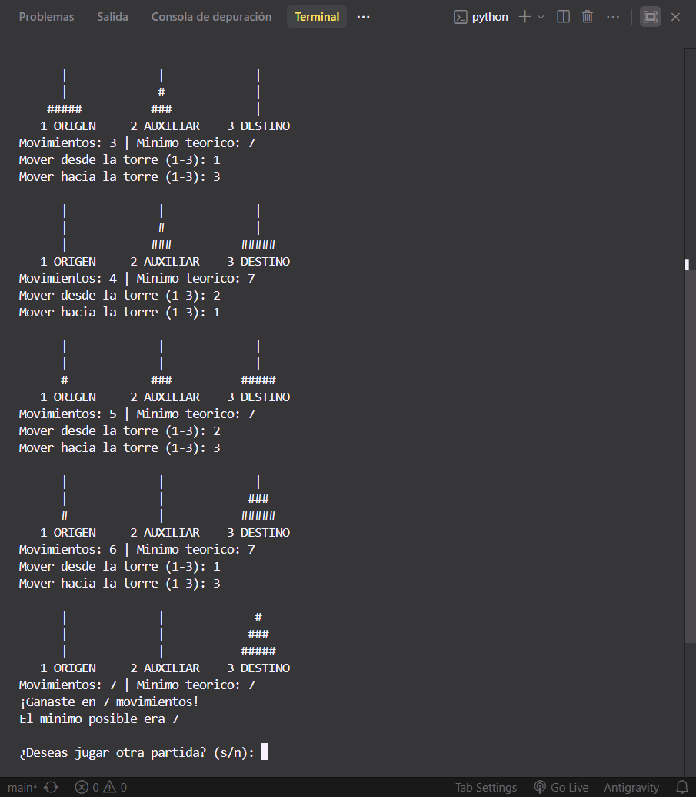 |
| *Figura 6: Ingreso de la torre 5. La regla 1 notifica que la torre no existe e instruye al usuario a emplear valores entre 1 y 3.* | *Figura 7: Resolución exitosa en 7 movimientos exactos coincidiendo con el mínimo teórico ($2^3 - 1 = 7$) y despliegue del menú de revancha.* |

---

### 8.3 Interfaz Gráfica: Temas Visuales, Interactividad y Victoria

| Evidencia 08: Modo Navidad (Noche) 🌙 | Evidencia 09: Modo Navidad (Día) ☀️ |
| :---: | :---: |
| 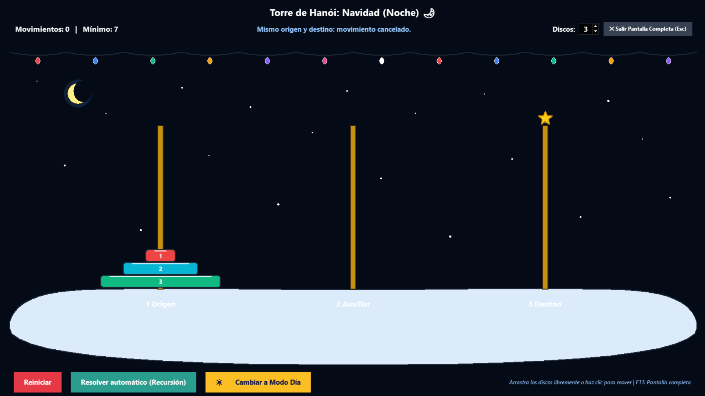 | 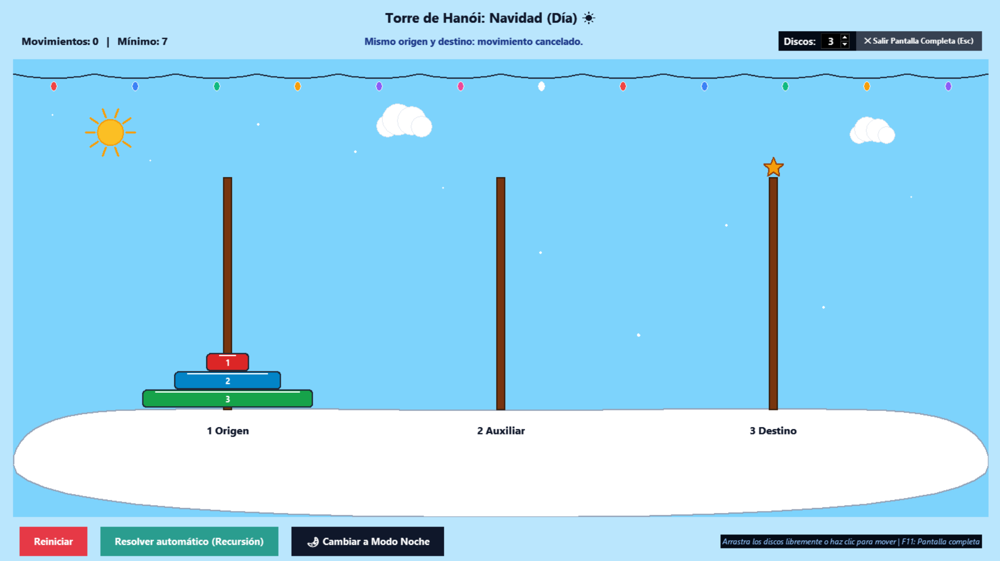 |
| *Figura 8: Tablero en ambientación nocturna con Luna creciente, cielo estrellado y guirnalda de luces.* | *Figura 9: Tablero tras presionar el botón de alternancia: cielo azul diurno con Sol radiante y nubes.* |

| Evidencia 10: Arrastrar y Soltar (*Drag & Drop*) | Evidencia 11: Rechazo Visual de Jugada |
| :---: | :---: |
| 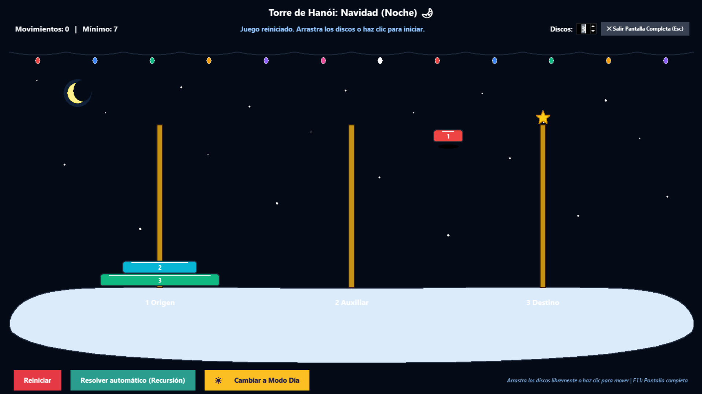 | 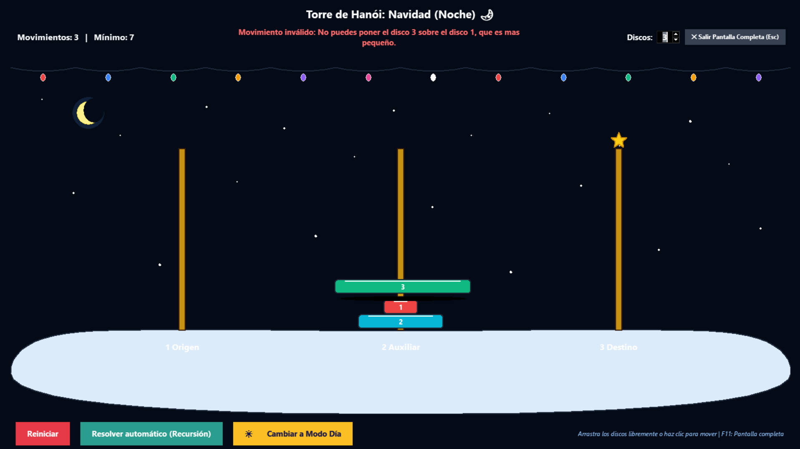 |
| *Figura 10: Manipulación del disco en tiempo real con el ratón. Nótese la sombra de sustentación proyectada en el aire.* | *Figura 11: Rechazo en rojo en el banner de avisos al soltar un disco ilegal; el disco regresa de inmediato a su poste.* |

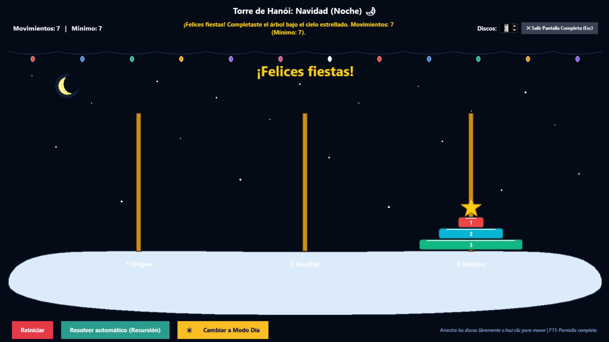  
*Figura 12: Estado final de victoria. La Estrella Dorada corona la cúspide de la Torre 3 formando el Árbol de Navidad, acompañado por el letrero superior festivo «¡Felices fiestas!».*

---

## 9. Guion Metodológico para la Defensa Oral

Para la evaluación oral ante el docente o la presentación en feria académica, el equipo estructuró un cronograma de 5 minutos:

| Tiempo | Contenido de la Exposición | Expositor |
| :---: | :--- | :---: |
| **0:00 - 1:00** | Presentación institucional del proyecto y justificación matemática de por qué las torres son pilas LIFO. | Oscar Fabricio Guevara Aguilar |
| **1:00 - 2:30** | Demostración práctica en vivo: un movimiento válido, un movimiento inválido con su motivo, arrastre libre con ratón y ejecución del botón recursivo. | Henry Aldair Zelaya Cortez (apoyo: Alex Gabriel Rivera Trujillo) |
| **2:30 - 4:00** | Explicación técnica del código modular: `torres.py`, `reglas.py`, consola interactiva y arquitectura de eventos en Tkinter. | Todo el Equipo (1 min c/u sobre sus archivos) |
| **4:00 - 5:00** | Ejecución en vivo de `pruebas.py` demostrando 22/22 OK, presentación de evidencias y conclusiones finales. | Isvi José Castillo Cruz |

### Banco de Preguntas Clave para la Defensa

1. **¿Por qué utilizaron listas con `push` y `pop` en lugar de una clase propia o nodos enlazados?**  
   *Respuesta:* Porque es la implementación nativa y canónica vista en las clases 12 y 16 de la cátedra (`funcionesPila.py`). La lista en Python permite operaciones `append` y `pop` en $\mathcal{O}(1)$ al final de la lista, satisfaciendo formalmente el comportamiento de una Pila sin añadir complejidad innecesaria.
2. **¿Por qué el contador de movimientos no se incrementa con jugadas inválidas?**  
   *Respuesta:* La función `mover_disco()` condiciona el incremento de `juego["movimientos"]` exclusivamente al valor booleano retornado por `validar_movimiento()`. Si una regla se viola, la jugada se descarta en su fase de validación sin alterar la estructura ni el contador.
3. **¿Cómo se conecta la interfaz gráfica con el motor de reglas sin duplicar código?**  
   *Respuesta:* Mediante una arquitectura desacoplada. La vista gráfica solo captura coordenadas del ratón, las traduce a índices de torre (0, 1 o 2) e invoca a `mover_disco()`. La interfaz no contiene reglas de Hanói; únicamente consulta el diccionario de estado y lo dibuja en el Canvas.
4. **¿Cómo garantiza la recursión de `resolver` que se utiliza el mínimo teórico?**  
   *Respuesta:* La estrategia recursiva traslada el subárbol de $n-1$ discos exactamente una vez hacia la torre auxiliar, realiza un único movimiento para el disco mayor hacia el destino y vuelve a trasladar el subárbol de $n-1$ discos sobre él. Esta secuencia genera la recurrencia estricta $T(n) = 2T(n-1) + 1$, cuya cota matemática mínima inalcanzable por debajo es exactamente $2^n - 1$.

---

## 10. Conclusiones y Aprendizajes

1. **Pertinencia de las Estructuras Abstractas:** El proyecto demostró que la elección adecuada de una estructura de datos (Pila) no es un mero formalismo teórico, sino una herramienta de simplificación algorítmica: al restringir el acceso a la cima, las reglas fundamentales del juego se imponen por naturaleza estructural.
2. **Desacoplamiento Efectivo (Arquitectura MVC):** Lograr que la interfaz web interactiva (`app.py` + `templates/` + `static/`) y la batería de pruebas automatizadas (`pruebas.py`) consuman de forma transparente el mismo núcleo de lógica (`reglas.py`, `torres.py`) valida la importancia de los principios de diseño de software modular y contratos de función estables.
3. **Dualidad Estructural en Recursión:** Comprender que la pila de llamadas (*Call Stack*) del procesador es idéntica en comportamiento a la pila de discos del juego afianzó el entendimiento profundo de los mecanismos internos de la memoria durante la ejecución de algoritmos recursivos.
